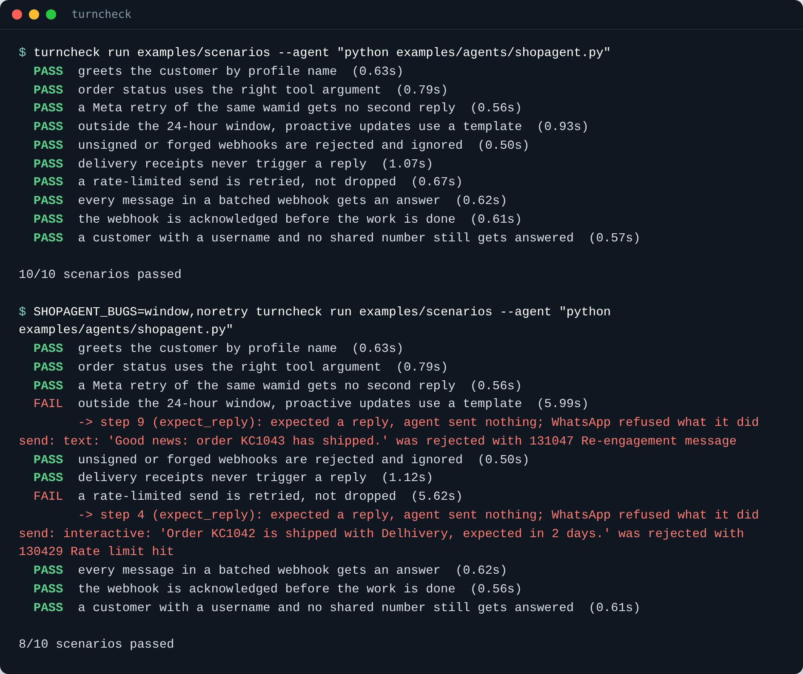

# turncheck

Regression tests for WhatsApp agents, run at the webhook level.

turncheck plays scripted conversations against your agent as real WhatsApp Cloud API
webhooks: signed with `X-Hub-Signature-256`, carrying real `wamid`s and timestamps. It
records what the agent sends back to the Graph API. A scenario can redeliver a message,
send a delivery receipt, jump the clock forward 25 hours, or forge a signature, then
check that the agent did the right thing.

It's for people who ship WhatsApp agents to clients and want CI to fail before a prompt
change or a refactor reaches a customer's phone.



## Quick start

```bash
git clone https://github.com/yashere69/turncheck && cd turncheck
pip install .
turncheck run examples/scenarios --agent "python examples/agents/shopagent.py"
```

No Meta account and no API keys are needed. The example agent is stdlib Python with a
rule-based router standing in for the LLM.

## Why not just test the prompt?

Prompt-level eval tools such as [promptfoo](https://www.promptfoo.dev/docs/configuration/chat/)
are good at "does the model say the right thing". Many of the ways a WhatsApp agent breaks
in production are somewhere else:

- **Duplicates.** Meta retries a webhook if your endpoint is slow or errors, and keeps
  retrying for days. Without deduplication on `wamid`, the customer gets the same answer
  twice.
- **The 24-hour window.** Outside 24 hours since the customer's last message, the
  business can only send pre-approved templates. Since Meta's July 2025 pricing change,
  the window also decides what a message costs.
- **Status webhooks.** `sent`, `delivered` and `read` receipts arrive on the same endpoint
  as messages. Agents that don't tell them apart reply to receipts.
- **Signatures.** An endpoint that skips HMAC verification will act on anyone's POST.
- **Tool arguments.** "order #KC1042" and "order KC1042" should end up as the same tool
  call.

None of these show up in a prompt test. They do show up when you send the real envelope
to the real endpoint, so that's what turncheck does.

The closest earlier tool is Botium's [WhatsApp connector](https://github.com/codeforequity-at/botium-connector-whatsapp),
which also emulated the API and captured outbound messages. It targets the older on-premise
WhatsApp Business API, needs Redis and the Botium stack, has no signature, retry, receipt or
window handling, and hasn't changed since 2020.

## Writing a scenario

```yaml
name: outside the 24-hour window, proactive updates use a template
customer: {wa_id: "919800000004", name: Kabir}
steps:
  - send: "order KC1043 status"
  - expect_tool: {name: lookup_order, args: {order_id: KC1043}}
  - expect_reply: {contains: "packed"}
  - advance: 25h
  - event: {path: /events/order-shipped, json: {order_id: KC1043}}
  - expect_reply: {type: template, template: order_update}
```

| Step | What it does |
|---|---|
| `send: "text"` | customer text message (tag it with `as: name` to redeliver it later) |
| `press: {id, title}` | customer taps an interactive reply button |
| `redeliver: name` | re-POST the identical payload, same `wamid` |
| `status: {state: delivered}` | delivery receipt for the agent's last message |
| `send_tampered: "text"` | message with a wrong signature |
| `advance: 25h` | move the simulated clock (s, m, h, d) |
| `event: {path, json}` | POST to one of your agent's own endpoints, with the simulated time added as `timestamp` |
| `expect_reply: {...}` | next outbound message; `type`, `contains`, `not_contains`, `matches`, `template`, `buttons` |
| `expect_no_reply: {}` | the agent sent nothing in response to the last stimulus |
| `expect_tool: {name, args}` | next traced tool call |
| `expect_http: 401` | status code of the last webhook POST (`4xx` also accepted) |

`turncheck lint <dir>` validates scenario files without running anything.

**Every reply has to be accounted for.** If the agent sends a message that no
`expect_reply` consumes before the next customer step (or the end of the scenario), the
scenario fails with "reply not covered by any expect". Double replies are one of the most
common WhatsApp agent bugs, and they don't only come from webhook retries. If a scenario
legitimately sends extra messages you don't care about, set `allow_extra_replies: true` at
the top of the file.

## Connecting your own agent

turncheck starts your agent as a subprocess and passes it these environment variables:

| Variable | Use it for |
|---|---|
| `PORT` | where your webhook server listens; turncheck POSTs to `/webhook` |
| `GRAPH_API_BASE` | base URL for sending messages, in place of `https://graph.facebook.com` |
| `WHATSAPP_TOKEN`, `PHONE_NUMBER_ID` | as in production |
| `APP_SECRET`, `VERIFY_TOKEN` | signature check and `GET /webhook` verification |
| `TURNCHECK_TRACE_URL` | read by `turncheck.trace.tool_call()`; unset in production, so the call is a no-op |

To make tool calls assertable, add one line where the agent executes a tool:

```python
from turncheck import trace
trace.tool_call("lookup_order", {"order_id": order_id})
```

Your agent probably already has its own names for these settings and its own webhook
path. You don't need to change it; map them on the command line:

```bash
turncheck run tests/whatsapp --agent "node dist/server.js" --webhook-path /api/whatsapp \
  --env META_APP_SECRET={app_secret} --env WA_API_BASE={graph_api_base} \
  --env WA_ACCESS_TOKEN={access_token}
```

Placeholders: `{graph_api_base}`, `{app_secret}`, `{access_token}`, `{verify_token}`,
`{phone_number_id}`, `{port}`, `{trace_url}`. Use `{{`/`}}` for a literal brace.

The agent should compute the 24-hour window from message `timestamp`s, not from
`time.time()`. That's what makes `advance: 25h` work, and it's also correct when webhooks
arrive late.

## In CI

```yaml
- uses: yashere69/turncheck@v0.1.0
  with:
    scenarios: tests/whatsapp
    agent: node dist/server.js
```

The action writes JUnit XML to `turncheck-junit.xml` for your test reporter.

## Reading what happened

`--transcripts runs.jsonl` writes every scenario as a conversation (customer messages,
agent replies, tool calls) in the trace format [chatlens](https://github.com/yashere69/chatlens)
reads, with pass/fail and the first failure in `meta`. When a real LLM is behind the
agent, `chatlens serve runs.jsonl` is the quickest way to read its replies and label what
went wrong. chatlens can also turn failed conversations back into turncheck scenarios.

## Does it actually catch things?

The reference agent (`examples/agents/shopagent.py`) has five seeded bugs, switched on
through `SHOPAGENT_BUGS`. `python tools/mutation.py` runs the suite once against the clean
agent and once per bug, and writes [results/mutation.md](results/mutation.md):

| Seeded bug | Caught by |
|---|---|
| `dedup` — no idempotency on `wamid` | 03-duplicate-delivery |
| `window` — free-form text after 24 h | 04-window |
| `orderid` — regex misses `#KC1042` | 02-order-status |
| `signature` — HMAC check skipped | 05-signature |
| `status` — replies to receipts | 06-status-receipts |

5 of 5 caught, with no failures on the clean agent. The same check runs in CI as
`tests/test_end_to_end.py`. These bugs were written to be caught, so this shows the
harness works end to end. It doesn't show turncheck will find your bugs; your scenarios
decide that.

## Design notes

[docs/architecture.md](docs/architecture.md) covers the run lifecycle. The short version:

- **Real HTTP, fresh process per scenario.** Transport bugs only show up over the
  transport, and a restart stops dedup sets or session state leaking between tests. That
  costs about half a second per scenario.
- **A simulated clock**, so window tests take milliseconds, not a day.
- **Wait for quiet, not fixed sleeps.** Agents should acknowledge first and reply on
  another thread, so turncheck polls until nothing new arrives for `--settle-ms`.
- **Tool tracing is opt-in and explicit**, rather than scraped from logs.

## Not in 0.1

- Media messages, WhatsApp Flows, calling, multiple phone numbers per test
- Recording and replaying LLM responses. Today a real LLM behind the agent makes runs
  non-deterministic, and assertions have to be written loosely (`contains`, type,
  tool arguments).
- The payload shapes are hand-written from Meta's webhook format. If Meta adds fields, the
  envelopes won't have them until they're added here.

## Layout

```
src/turncheck/      library and CLI
examples/agents/    reference agent with switchable bugs
examples/scenarios/ the six scenarios above
tools/mutation.py   regenerates results/mutation.md
docs/               architecture notes, screenshots
```

## Development

```bash
pip install -e ".[dev]"
ruff check . && ruff format --check . && mypy src && pytest
```

MIT licensed.
